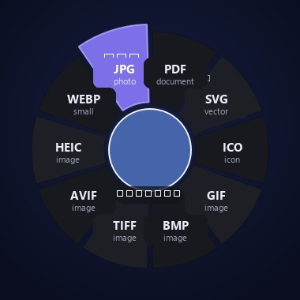

<div align="center">


# LKB Orbit

### Any file. Any format. One shortcut.

Convert files on Windows right from your desktop — **start dragging a file, hold `Shift`,
and drop it on a format in the radial menu.** No websites, no uploads, no Office required.

[](LICENSE)


[**⬇ Download**](../../releases/latest) · [How to use](#how-to-use) · [What it converts](#what-it-converts) · [Build from source](#run-from-source) · [Contributing](#contributing)



</div>

---

## Why LKB Orbit?

| | |
|---|---|
| **Right at your cursor** | No window to open. A radial menu appears where you already are, showing only the formats that make sense for the file you dragged. |
| **Stays on your computer** | 100% offline. Nothing is uploaded. The result is saved next to the original. |
| **Your files are safe** | Originals are never modified or deleted, outputs never overwrite existing files, and a built-in safety net refuses to ever touch a source file. |

## Download

Get the latest build from the [**Releases page**](../../releases/latest):

- **`LKB Orbit.exe`** — a single portable file. No installer, no admin rights. Double-click and it lives in your system tray.

> On first run, Windows SmartScreen may warn because the app isn't code-signed yet.
> Click **More info → Run anyway**. The full source is in this repo.

## How to use

1. Start dragging a file in File Explorer (or on the desktop).
2. Hold **`Shift`** — the menu opens under your cursor and a preview of the file pops into the center.
3. Drop the file on a slice. A **progress ring** fills right there, then a **green check** — done.
4. Tap **`Shift`** again while it's open to switch between **Convert** and **Tools**.

No drag? **Double-click the tray icon** to pick a file and click a slice, or enable the
**right-click → "Convert with LKB Orbit"** entry from the tray menu.

## What it converts

| Category | Formats in | Convert to | Tools |
|----------|-----------|-----------|-------|
| **Images** | PNG · JPG · WEBP · HEIC · AVIF · TIFF · BMP · GIF · ICO | any image, PDF, or **SVG** (trace) | Compress · Resize · several images → one PDF |
| **PDF** | PDF | JPG / PNG (per page) · DOCX · TXT | Merge · Split (pick pages) · Rotate · Compress |
| **Word** | DOCX · DOC · ODT · RTF | PDF · TXT | — |
| **Spreadsheets** | XLSX · XLS · CSV · TSV · ODS | PDF · CSV · XLSX | — |
| **Presentations** | PPTX · PPT · ODP | PDF · PNG · TXT | Split (pick slides) |
| **E-books** | EPUB | PDF · TXT | — |
| **Vector** | SVG | PNG · JPG · PDF | — |
| **Text** | TXT · MD · JSON · XML · HTML · … | PDF · DOCX | — |

**Highlights**

- **In-place progress** — the menu turns into a live ring with a real **%** for multi-page/slide jobs.
- **Multi-page jobs auto-folder** — PDF/PPT → images drop into a folder named after the file.
- **Split by page/slide** — click exactly the pages or slides you want to pull out.
- **OneDrive-aware** — cloud-only files are downloaded automatically before converting.
- **SVG both ways** — trace an image to SVG, or render an SVG to PNG/JPG/PDF.
- Most conversions are **pure Python** (no external tools). A few (`.doc` / `.odt` / `.rtf`, `.ods`,
  `.ppt` / `.odp`) use **LibreOffice** if it's installed, and say so clearly if it isn't.

## Install (optional)

The exe is portable, but you can install it for Start-Menu/Desktop shortcuts and
start-with-Windows. From a PowerShell prompt in the repo folder:

```powershell
# copies the exe to %LOCALAPPDATA%\Programs\LKB Orbit and adds shortcuts + an uninstall entry
.\scripts\install.ps1
```

Remove it any time from **Settings → Apps → LKB Orbit → Uninstall**.

## Run from source

```bash
git clone https://github.com/lohithkrishnabhagavan95-png/LKB-Orbit.git
cd LKB-Orbit
python -m venv .venv
.venv\Scripts\pip install -r requirements.txt
.venv\Scripts\pythonw run.py
```

Run the tests:

```bash
.venv\Scripts\pytest -q
```

## Build the standalone exe

```bash
.venv\Scripts\pip install pyinstaller
.venv\Scripts\pyinstaller "LKB Orbit.spec"
```

Output: `dist/LKB Orbit.exe`. Regenerate the logo/icons with `python tools/make_logo.py`.

## How it works

```
quickconvert/
  engine.py      all file processing (Pillow · PyMuPDF · python-docx · openpyxl · python-pptx
                 · pillow-heif · EbookLib · vtracer · QtSvg). Pure & testable; protects originals.
  render.py      self-contained .pptx -> image renderer (no external software needed)
  trigger.py     the drag+Shift watcher (polls GetAsyncKeyState — no admin, no hooks)
  menu.py        the radial menu (drop-on-slice, two-ring toggle, pop-in preview, in-place progress ring)
  dialogs.py     the page/slide picker for Split
  integration.py start-with-Windows + Explorer right-click (HKCU only)
  app.py         tray icon, background jobs, notifications, single-instance handoff
  util.py        file categories, output paths, config
  assets/        logo + app icon
run.py           entry point
tests/           engine round-trip tests
tools/           logo generator
```

- The **trigger** polls global input state (button held + movement + Shift) — no admin, no fragile hooks.
- The **engine** is UI-free, so every conversion is covered by a round-trip test in `tests/`.
- Jobs run on a background thread pool, so the menu stays responsive, and progress is reported per page/slide.

## Verified

- `pytest` — 16 engine round-trips across every category (images, PDF, Office, e-books, SVG, text).
- `"dist/LKB Orbit.exe" --selftest` — the packaged exe exercises every bundled engine and exits 0.
- Originals are checksum-verified unchanged after conversion in the test suite.

## Contributing

Contributions of any size are welcome — issues and pull requests both. A good PR:

- keeps `engine.py` UI-free and adds a round-trip test in `tests/` for any new conversion,
- runs `pytest -q` green, and
- matches the existing style (small, readable functions).

New conversions usually slot in as one entry in `engine.TOOLS` / a dispatch branch, plus a
small dialog for options — easy to add.

## Roadmap

- Code-signing so SmartScreen stops warning
- Optional auto-setup of a portable LibreOffice for full-fidelity Office conversion
- Batch multi-file drops with per-file results

## License

[MIT](LICENSE) — free to use, modify, and distribute.

© 2026 Lohith Krishna Bhagavan and the LKB Orbit contributors.
